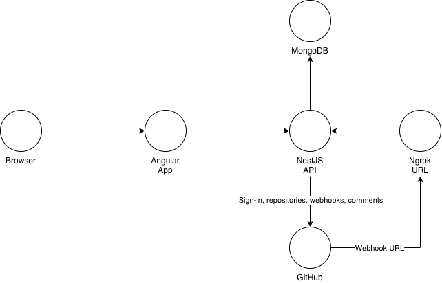
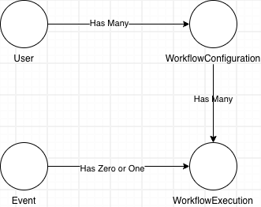

# Workflow Automation

## Installation

### Prerequisites

You need Node.js 22.22 or newer; [nvm](https://github.com/nvm-sh/nvm) is the easiest way to install and switch to it, and `nvm use` picks the version from `.nvmrc`. The repository is a [Rush](https://rushjs.io) monorepo, so install Rush globally with `npm install -g @microsoft/rush`. You also need Docker, which runs MongoDB locally and in the backend tests.

GitHub has to reach the API to deliver webhooks, so you also need [ngrok](https://ngrok.com); a free account is enough. Install it and add your auth token once with `ngrok config add-authtoken <token>`.

Signing in requires a GitHub OAuth App:

1. Open [New OAuth App](https://github.com/settings/applications/new) on GitHub (Settings → Developer settings → OAuth Apps → New OAuth App).
2. Fill in any application name, `http://localhost:4200` as the homepage URL and `http://localhost:4200/api/auth/github/callback` as the authorization callback URL, and leave device flow off.
3. Register the application, then generate a client secret. Keep the client id and the secret for the `.env` file; GitHub only shows the secret once.

The API builds the callback from the address you open the app on, so the callback URL registered on GitHub must use that same address.

### Installing

From the repository root, run `rush install` to install every project's dependencies from the committed lockfile. Run `rush update` instead after changing a `package.json`, so the lockfile is updated too. Then run `rush build` to build every project and `rush test` to run their tests. `rush lint` and `rush check-format` check the code style, and `rush lint --fix` and `rush format` fix it.

## Execution

Start ngrok with `ngrok http 3000` and keep the `https://…` address it prints. Copy `.env.example` to `.env` and fill it in: `PUBLIC_URL` with that ngrok address, the OAuth App's client id and secret, and the three secrets, each a random value of at least 32 characters from a password generator such as [1Password's](https://1password.com/password-generator).

Then start MongoDB with `docker compose up -d mongodb`. It listens on port 27117, so it doesn't clash with a MongoDB you may already run on the default port. Then start the API with `rushx start:dev` from `backend/` and the web app with `rushx start` from `frontend/`, and open `http://localhost:4200`. The web app forwards `/api` to the API.

ngrok only matters for webhooks: turning a workflow on registers a webhook on its repository pointing to `PUBLIC_URL`, while the OAuth App stays on `localhost:4200`. On ngrok's free plan the address changes on every restart and existing webhooks keep the old one, so update `PUBLIC_URL`, restart the API, and turn your workflows off and on to re-create them.

## Architectural decisions

- **Rush monorepo with pnpm**: the backend and the frontend share common definitions, like the Zod schemas and the app catalog, so I needed a monorepo. Rush is the monorepo tool I've used for 7 years to share this kind of definitions easily.
- **MongoDB driver with Zod**: I chose the official MongoDB driver over Mongoose. Zod already describes every entity, so a Mongoose schema would just repeat it. Every write is parsed with Zod before it reaches the database.
- **UUIDs as `_id`**: every id is a UUID from `crypto.randomUUID()`, set explicitly on insert. I use `_id` as is in the database, the API and the frontend, so there's no ObjectId and no mapping to `id`.
- **Soft deletes for workflows**: deleting a workflow sets `deletedAt` instead of removing it, so the events it received can still point back to it. Its GitHub webhook is removed anyway.

### Data model

A user has many workflow configurations, and each configuration has many executions. Every webhook delivery is saved as a workflow event, even when it runs nothing, so we can tell why a workflow didn't fire.

I chose to let the source fan out the events, not the application. Each workflow registers its own webhook and keeps its hook id, so one delivery runs exactly one workflow and a failure in one workflow never affects the others.

An execution points to its event through a unique `eventId`, so an event runs at most one workflow.

## Follow-ups

- Sources that only allow a single subscription (like WhatsApp) would need the application to split each delivery into one job per workflow as soon as it arrives.
- Dropping the unique `eventId` index would allow one event to have many executions, without changing the schema.
- Reprocessing: a retry adds an attempt to the existing execution instead of creating a new one, so an event keeps at most one execution.
